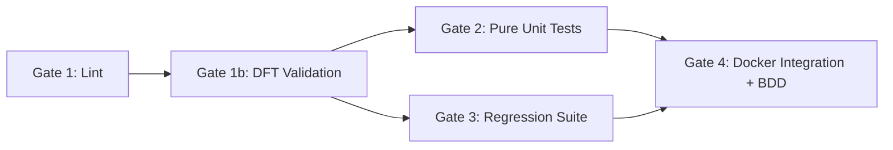

# imi-wordpress v1.0.0

WordPress REST API client, scholarly preprint registry, and safe mutation toolkit for Independent Media Institute (`independentmediainstitute.org`).

Built to **phosphene axiomatic standards** — six Design-for-Testability (DFT) axioms enforced by an AST validator in CI. Pure logic is isolated from I/O, time is injectable, domain models are pure POPOs, and every mutating operation carries its own proof.

---

## What It Does

- **Preprint Pure Domain Model (`domain.py`)** — Pure POPO domain entities for scholarly preprints (`PreprintEntry`, `Author`, `DOI`, `DOIRecord`, `DOIStatus`, `EditorialState`, `License`, `VersionInfo`). All classes are `frozen=True`, `slots=True`, `kw_only=True` with zero wire format or network dependencies.
- **Wire & Scholarly Adapters (`adapters.py`)** — Port-and-Adapter architecture mapping pure domain objects to/from WordPress REST meta payloads (`reg_*`) and Schema.org JSON-LD (`@type: ScholarlyArticle`).
- **Dual-Language Parity (PHP 8.2+)** — 1:1 mirror of the domain model in pure PHP (`src/php/Domain/`), featuring `PostMetaHydrator`, `GoogleScholarAdapter`, `SchemaJsonLdAdapter`, and `RegistryCPTConfig` declaring 39 canonical fields.
- **UrllibWPClient (`client.py`)** — Real REST API client with `get_page`, `get_meta`, `update_page`, `create_post`, `list_revisions`. Advertises `User-Agent: UrllibWPClient/1.0.0`.
- **DryRunWPClient (`dryrun.py`)** — Records call intents without writing; generates cryptographic proofs of safe publication.
- **WPEngineDBClient (`db_client.py`)** — Direct persistence access via token-authenticated mu-plugin gateway (`imi-diagnostics.php`), executing raw SQL updates that bypass WordPress `wp_slash()` JSON corruption.
- **ElementorPageModel (`elementor_model.py`)** — AST validation for `_elementor_data` JSON with schema enforcement, widget extraction, `remove_widget_by_id`, and structural diffing.
- **WordPressDualHarness (`parity_harness.py`)** — Dual-layer parity verification (REST API vs direct SQL) and 5-phase safe write pipeline (`backup` → `dry-run` → `write` → `parity` → `render`).
- **WordPressOutlet (`pipeline.py`)** — Idempotent publication seam for upstream sagas (`woodchipper`, Temporal workflows). Verifies post slugs before creation to guarantee retry safety.
- **BDD Orchestration (`features/`)** — Executable Gherkin specifications verifying preprint lifecycle, idempotency, author sequencing, DOI withdrawal, and publication orchestration.

---

## The Six DFT Axioms

| Axiom | Rule | Enforcement |
|:---|:---|:---|
| **A1** pure-io-separation | Logic modules import zero I/O; all I/O is isolated in wiring modules or behind Protocol interfaces | AST validator in CI |
| **A2** determinism | No unseeded `datetime.now()`, `random`, or `uuid` in logic; inject a `Clock` | AST validator in CI |
| **A3** manifest-conformance | Custom post type payload keys must strictly conform to declared schema | Ast / schema validation |
| **A4** dft-docs | Every module must declare a `@dft` docstring section stating applied axioms | AST validator in CI |
| **A5** mock-doubles | Real in-process test doubles (`FakeWPClient`, `FakeDBClient`), never blind mock specs | Unit tests in CI |
| **A6** check-result | Mutating functions return structured result dataclasses containing proof of execution | Parity & pipeline tests |

Enforced on every commit by `python -m phosphene.imi_wordpress.foundry_cli validate`.

---

## Versioning & Release Advertising

`imi-wordpress` adheres to **Semantic Versioning (SemVer 2.0.0)**. The package version is advertised consistently across Python, PHP, CLI, and HTTP headers:

- **Python Package:** `phosphene.imi_wordpress.__version__` (`1.0.0`) and `__version_info__` (`(1, 0, 0)`)
- **CLI:** `python -m phosphene.imi_wordpress.foundry_cli --version` prints `imi-wordpress 1.0.0`
- **HTTP User-Agents:**
  - `UrllibWPClient/1.0.0`
  - `WPEngineDBClient/1.0.0`
  - `WordPressDualHarness/1.0.0`
- **PHP Plugins & Schemas:**
  - `RegistryCPTConfig::VERSION = '1.0.0'`
  - `IMI_CITATION_META_VERSION = '1.0.0'`
  - `IMI_Diagnostics version = '1.0.0'`

### Release Process
1. Update version in `pyproject.toml`, `src/phosphene/imi_wordpress/__init__.py`, and PHP constants.
2. Run full test suite and verify all CI gates pass green.
3. Commit release bump: `git commit -am "chore(release): bump version to X.Y.Z"`
4. Tag annotated git release: `git tag -a vX.Y.Z -m "Release vX.Y.Z"`
5. Push to origin: `git push origin main --tags`
6. Publish GitHub Release: `gh release create vX.Y.Z --title "vX.Y.Z" --notes "..."`

---

## Installation

```bash
uv sync --extra dev
```

---

## Testing

The repository features a multi-layered testing pyramid running under 1 second locally:

```bash
# 1. DFT Validation (verifies all six axioms across codebase)
uv run python -m phosphene.imi_wordpress.foundry_cli validate

# 2. Pure Unit Tests (Python domain, adapters, fakes, elementor AST — 271 tests in <0.5s)
uv run pytest tests/ --ignore=tests/integration -q

# 3. Pure Unit Tests (PHP 8.2 domain POPOs, hydrators, citation adapters — 18 tests in 0.01s)
/usr/local/bin/php tests/php/run-pure-tests.php

# 4. Regression Suite (wp_slash regression & 8-case mutation matrix)
uv run pytest tests/ --ignore=tests/integration -q -m regression

# 5. BDD Features (14 scenarios, 88 steps across system boundaries)
uv run behave features/

# 6. Docker Integration Tests (Ephemeral runner stack via programmatic test_setup.py)
docker compose -f compose.test.yml up -d
WP_INTEGRATION=true uv run pytest tests/integration/ -v
docker compose -f compose.test.yml down -v
```

---

## CI / CD Pipeline

All pull requests and pushes to `main` must pass a 5-gate pipeline on GitHub Actions:



1. **Gate 1: Lint** — `ruff check` + `ruff format --check`
2. **Gate 1b: DFT Validation** — `foundry_cli validate` (pure AST validation of axioms A1, A2, A4)
3. **Gate 2: Pure Unit Tests** — Pytest suite run without external services
4. **Gate 3: Regression Suite** — Parity harness regression and string mutation matrix
5. **Gate 4: Docker Integration + BDD** — Ephemeral WordPress + MySQL + Elementor container initialized programmatically via `test_setup.py`

---

## Architectural Documentation & Guides

- [docs/PIPELINE_INTEGRATION.md](docs/PIPELINE_INTEGRATION.md) — Comprehensive guide and non-negotiable standards for upstream pipeline sagas and ingestion workers.
- [war_stories.md](war_stories.md) — Comprehensive chronicle of past production failure modes (`wp_slash` corruption, wire leaks, Crossref metadata drift) and strict coding standards for agents.
- [DESIGN.md](DESIGN.md) — System architecture, persistence layers, parity harness, and safe write pipelines.
- [LOCAL_TESTING.md](LOCAL_TESTING.md) — Guide for running local integration and PHP test suites.
- [docs/DOI-CROSSREF-GUIDE.md](docs/DOI-CROSSREF-GUIDE.md) — IMI Crossref account operations (Member 57537, prefix `10.67767`).
- [AGENTS.md](AGENTS.md) — Architectural rules and invariants for AI pair programmers.
